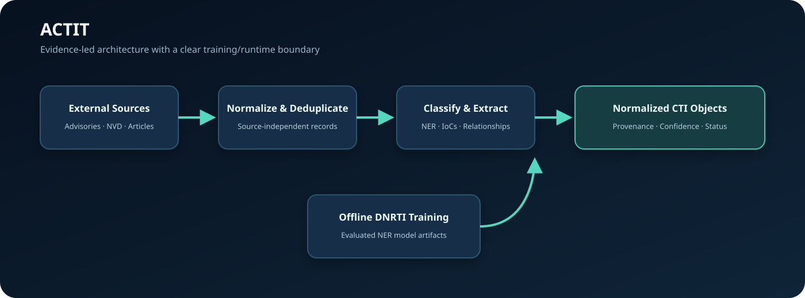
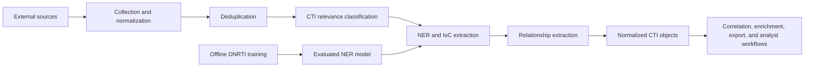

# CTI-Tool Showcase

**AI-Based Cyber Threat Intelligence Platform**

CTI-Tool is a collaborative graduation project for collecting, normalizing, classifying, enriching, correlating, and presenting cyber threat intelligence. This compact companion repository preserves a sanitized architecture overview, demonstration, and selected model-evaluation evidence. The current implementation and operational documentation are available in the public [ACTIT / CTI-Tool repository](https://github.com/AmmarAikan/CTI-Tool).

## Repository Status

This showcase is a portfolio-oriented snapshot, not the canonical source tree or the current implementation-status record. Use the main [CTI-Tool README](https://github.com/AmmarAikan/CTI-Tool#readme) for implemented capabilities, setup, tests, architecture, and known deployment boundaries.

## What the Project Demonstrates

- Offline DNRTI named-entity recognition training and evaluation
- External CTI ingestion through normalized connector contracts
- Cleaning, normalization, and duplicate detection
- Explicit CTI relevance classification with backend metadata
- Named-entity and indicator-of-compromise extraction
- Rule-based relationship extraction with clear provenance
- A shared CTI object schema designed for future correlation and export
- Failure isolation and focused automated tests

## Architecture

The design deliberately separates offline model training from runtime processing. It also treats structured security telemetry differently from ordinary unstructured documents.

## Demonstration

The [sanitized input](demo/sample-input.json) uses reserved documentation indicators rather than real infrastructure. Its [sample output](demo/sample-output.json) shows the public CTI object shape without exposing production code, credentials, private data, or operational collection details.

The [selected schema example](examples/selected-schema-example.py) is a reduced technical sample for review. It is not the complete runtime implementation.

## Results

The evaluated transformer NER model achieved:

| Metric | Result |
|---|---:|
| Precision | 0.7614 |
| Recall | 0.8020 |
| F1 | 0.7812 |
| Token accuracy | 0.9376 |

See [evaluation details](results/evaluation.md) for scope and limitations.

## Technologies

Python, scikit-learn, Transformers, PyTorch, structured JSON, dataclasses, unittest, NLP/NER, and cyber threat intelligence concepts including IoCs, relationships, enrichment, STIX/TAXII, and MISP-oriented workflows.

## Scope of This Showcase

The files here demonstrate the offline DNRTI NER pipeline and an early external runtime CTI pipeline with synthetic or reserved examples. They do not reproduce the complete application. The main repository now documents and implements PostgreSQL persistence, API and dashboard workflows, internal telemetry ingestion, enrichment, correlation, STIX export, and optional MISP sharing. Those capabilities retain explicit prototype and deployment limitations in the canonical documentation and are not implied by the reduced examples in this showcase.

## Team

This is a collaborative project maintained by the CTI-Tool project contributors, including:

- [Ammar Aikan](https://github.com/AmmarAikan)
- [Munif Aomisi](https://github.com/munifaomisi)
- [Alaa](https://github.com/Alshowie2026)

## Source Code and Rights

The complete ACTIT source is maintained in the public [CTI-Tool repository](https://github.com/AmmarAikan/CTI-Tool), where original ACTIT software and documentation are available under the MIT License subject to the repository's third-party notices. This separate showcase remains available for portfolio review and technical demonstration under its own [copyright notice](COPYRIGHT.md).

© 2026 CTI-Tool Project Contributors. All Rights Reserved.
