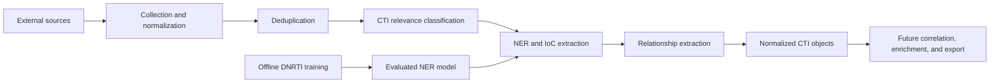

# CTI-Tool Showcase

**AI-Based Cyber Threat Intelligence Platform**

CTI-Tool is a collaborative graduation project for collecting, normalizing, classifying, and enriching cyber threat intelligence. This public repository presents the architecture, methodology, sanitized demonstrations, and measured results. The complete implementation is maintained in a private team repository.

## What the Project Demonstrates

- Offline DNRTI named-entity recognition training and evaluation
- External CTI ingestion through normalized connector contracts
- Cleaning, normalization, and duplicate detection
- Explicit CTI relevance classification with backend metadata
- Named-entity and indicator-of-compromise extraction
- Rule-based relationship extraction with clear provenance
- A shared CTI object schema designed for future correlation and export
- Failure isolation and focused automated tests

## Architecture

The design deliberately separates offline model training from runtime processing. It also treats structured security telemetry differently from ordinary unstructured documents.

## Demonstration

The [sanitized input](demo/sample-input.json) uses reserved documentation indicators rather than real infrastructure. Its [sample output](demo/sample-output.json) shows the public CTI object shape without exposing production code, credentials, private data, or operational collection details.

The [selected schema example](examples/selected-schema-example.py) is a reduced technical sample for review. It is not the complete runtime implementation.

## Results

The evaluated transformer NER model achieved:

| Metric | Result |
|---|---:|
| Precision | 0.7614 |
| Recall | 0.8020 |
| F1 | 0.7812 |
| Token accuracy | 0.9376 |

See [evaluation details](results/evaluation.md) for scope and limitations.

## Technologies

Python, scikit-learn, Transformers, PyTorch, structured JSON, dataclasses, unittest, NLP/NER, and cyber threat intelligence concepts including IoCs, relationships, enrichment, STIX/TAXII, and MISP-oriented workflows.

## Current Scope

Implemented work covers the offline DNRTI NER pipeline and an external runtime CTI pipeline. Database repositories, API routes, dashboard, correlation engine, enrichment services, internal telemetry processing, and MISP/STIX/TAXII export remain planned work and are not presented as complete.

## Team

This is a collaborative project maintained by the CTI-Tool project contributors, including:

- [Ammar Aikan](https://github.com/AmmarAikan)
- [Munif Aomisi](https://github.com/munifaomisi)
- [Alaa](https://github.com/Alshowie2026)

## Source Code and Rights

The complete source code is maintained in a private repository as part of the team's intellectual property. This showcase is available for portfolio review and technical demonstration only. See [COPYRIGHT.md](COPYRIGHT.md).

© 2026 CTI-Tool Project Contributors. All Rights Reserved.
